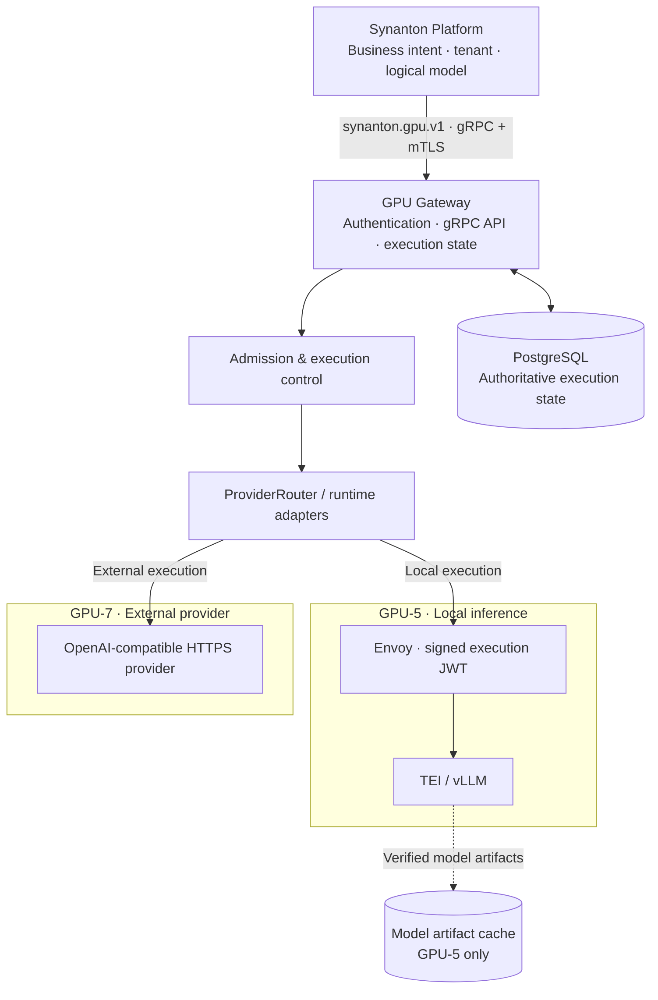
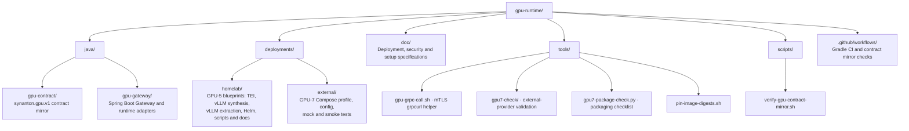

# Synanton GPU Runtime

[](https://github.com/synanton/gpu-runtime)
[](https://adoptium.net/)
[](https://spring.io/projects/spring-boot)
[](https://grpc.io/)
[](LICENSE)

**Synanton GPU Runtime** is the isolated model-execution plane for [Synanton Platform](https://github.com/synanton/platform). It provides a stable, authenticated gRPC boundary for inference workloads while keeping provider credentials, runtime lifecycle, execution state, and infrastructure details outside the platform.

The repository supports two deliberately separate deployment profiles:

- **GPU-5 — local inference:** serve models on an isolated Kubernetes GPU cluster using TEI and vLLM.
- **GPU-7 — external providers:** route to OpenAI-compatible inference providers from a container deployment, without requiring local GPUs or Kubernetes.

> **Project status:** this is an active development and validation repository, not a production-readiness claim. The latest checked-in acceptance evidence is date-scoped below; consult the linked plans before treating a test result as current operational availability.

## Responsibilities and boundaries

The system follows a simple division of responsibility:

| Component | Owns |
|---|---|
| **Synanton Platform** | Business intent, tenant identity, logical model selection, workflow orchestration, and CPU fallback |
| **GPU Runtime** | Authentication at the runtime boundary, admission, idempotency records, execution lifecycle, provider routing, and usage reporting |
| **Execution backend** | Model inference and provider-specific execution |
| **Infrastructure** | Placement, GPU device allocation, networking, storage, and deployment lifecycle |

The platform talks only to the GPU Runtime through the versioned `synanton.gpu.v1` gRPC contract over mTLS. It must not discover or call Kubernetes Pods, GPU nodes, vLLM/TEI endpoints, or external provider APIs directly. The Gateway is the runtime's network entry point.

## Architecture



### Request lifecycle

1. The platform submits a request using the gRPC contract and an authenticated mTLS identity.
2. The Gateway authenticates and authorizes the caller, validates the requested logical model and request limits, and records execution state in PostgreSQL.
3. Admission control applies model capabilities and configured concurrency limits before dispatch.
4. The selected runtime adapter executes against the local inference perimeter or a configured external provider.
5. The Gateway records the terminal state and usage information and exposes status through the contract.

Execution states include accepted/queued, model loading, running, and terminal success, failure, or cancellation. Terminal states are irreversible. Status reads can trigger lazy reconciliation of expired running leases; the design does not depend on a separate always-on controller.

### Deployment profiles

| | GPU-5: local inference | GPU-7: external provider |
|---|---|---|
| Compute | NVIDIA GPUs in Kubernetes | External provider; no local GPU required |
| Runtime | TEI for embeddings; vLLM for reranking and synthesis | OpenAI-compatible provider adapter |
| Perimeter | Gateway → signed execution JWT → Envoy → backend | Gateway → HTTPS provider API |
| Deployment | Kubernetes manifests and Helm chart | Docker Compose reference deployment |
| Main concerns | GPU placement, model artifacts, backend isolation, load/latency baselines | Provider credentials, model mapping, budget, sensitivity, failover, cost |

These profiles are not a single automatic fallback chain. GPU-7 does not silently fall back to local inference, and CPU fallback remains a platform responsibility.

## RAKG extraction workload

The homelab blueprints also include a dedicated [Qwen3-4B extraction workload](deployments/homelab/blueprints/vllm/extraction-llm.yaml) used by Synflux's `LlmExtractionAdapter` for the RAKG Phase B path. It uses the locally mirrored Qwen3-4B-Instruct-2507 artifact, a pinned vLLM image, an 8k context, and an explicitly allocated GPU. The recorded live adapter run against the frozen extraction gold reports **entity F1 0.618** and **relationship F1 0.078** (ADR-022). Treat these as a measured feasibility baseline—not a claim of production readiness or complete graph-extraction quality.


## Key capabilities

- **Versioned gRPC contract:** `synanton.gpu.v1`, mirrored from the platform repository and checked by `./gradlew check`.
- **Tenant-aware access control:** mTLS caller identity and authorization; GPU-5 additionally uses signed execution assertions at the Envoy boundary.
- **Durable execution state:** PostgreSQL is the source of truth for execution records and runtime control state.
- **Fail-closed request handling:** execution is not dispatched when its durable record cannot be established; idempotency uses request identity and deterministic request hashing.
- **Admission and capacity:** model capability, token/context constraints, and configured concurrency are checked before dispatch. The platform sees logical capacity, not physical GPU topology.
- **Runtime abstraction:** local vLLM and external provider implementations sit behind runtime/provider interfaces.
- **Artifact integrity (GPU-5):** model artifacts are digest-verified, staged, and atomically published into a shared read-only cache.
- **Provider controls (GPU-7):** logical-to-provider model mapping, streaming, circuit breaking, health, budget and cost accounting, sensitivity controls, kill switch, and multi-provider failover.
- **Privacy-conscious telemetry:** prompts, tokens, and authorization assertions must not be written to logs or traces.
- **Usage reporting:** input/output token usage and execution duration are made available for platform-side attribution.

## Technology

| Area | Technology |
|---|---|
| Language / framework | Java 21, Spring Boot 3.x |
| Build | Gradle (Kotlin DSL) |
| Service contract | gRPC, Protocol Buffers, Protovalidate |
| Persistence | PostgreSQL, Flyway, JDBC |
| Local inference | vLLM (including **Qwen3-4B-Instruct-2507** for RAKG extraction), Hugging Face Text Embeddings Inference (TEI) |
| External inference | OpenAI-compatible HTTPS provider APIs |
| Observability | Micrometer, Prometheus, OpenTelemetry |
| Tests | JUnit 5, AssertJ, Mockito, Testcontainers |
| Deployment | Kubernetes + Helm (GPU-5); Docker Compose (GPU-7) |

PostgreSQL is the authoritative store for execution state. Redis, Kafka, and Cassandra are not part of the current execution-state design.

## Repository map



## Build and test

### Prerequisites

- JDK 21 (Temurin or another compatible OpenJDK distribution)
- Docker for Testcontainers-backed integration tests
- Git

### Build

```bash
git clone https://github.com/synanton/gpu-runtime.git
cd gpu-runtime

# Full Gradle build (all applicable modules and verification tasks)
./gradlew build

# Or run focused tasks during development:
# Compile production sources
./gradlew compileJava

# Build the protobuf contract module
./gradlew :java:gpu-contract:build

# Run the Gateway test task
./gradlew :java:gpu-gateway:test

# Run the repository verification lifecycle, including contract mirror check
./gradlew check
```

The integration tests that require PostgreSQL/Testcontainers need a working Docker daemon. Some infrastructure-dependent tests are disabled by default so the ordinary local/CI test task can run without that environment; follow [Test Environment Setup](doc/TEST_ENVIRONMENT_SETUP.md) and the relevant test instructions before enabling them.

### Verify the platform contract mirror

`java/gpu-contract` must remain byte-identical to the contract in `synanton/platform`.

```bash
./scripts/verify-gpu-contract-mirror.sh

# When the platform checkout is not in the expected sibling location:
GPU_PEER_REPO=/path/to/platform ./scripts/verify-gpu-contract-mirror.sh
```

## Configuration

The Gateway is configured through Spring application properties, which can be overridden with environment variables. Common settings include:

| Property | Environment variable | Purpose |
|---|---|---|
| `gpu-gateway.grpc-port` | `GPU_GATEWAY_GRPC_PORT` | gRPC listener (default `9090`) |
| `gpu-gateway.dispatch.strategy` | `GPU_GATEWAY_DISPATCH_STRATEGY` | `stub`, `direct` (GPU-5), or `external` (GPU-7) |
| `gpu-gateway.dispatch.vllm-endpoint` | `VLLM_ENDPOINT` | Local vLLM endpoint |
| `gpu-gateway.execution.lease-timeout-seconds` | `EXECUTION_LEASE_TIMEOUT_SECONDS` | Execution lease duration |
| `gpu-gateway.execution.heartbeat-interval-seconds` | `EXECUTION_HEARTBEAT_INTERVAL_SECONDS` | Running execution heartbeat interval |
| `gpu-gateway.artifacts.cache-dir` | `MODEL_CACHE_DIR` | Local model artifact cache root |

Provider credentials belong in environment/secret configuration, never in committed files. For GPU-7, start from [`.env.example`](deployments/external/.env.example) and follow the [external deployment plan](deployments/external/gpu-7-implementation-plan.md). For GPU-5, follow the [homelab implementation plan](deployments/homelab/gpu-5-implementation-plan.md) and model setup guide.

## Current implementation and acceptance status

**Last reviewed: 2026-11-08**

The table below summarizes the latest evidence recorded in the repository's implementation plans. These are dated test results, not claims that a cluster or provider is reachable today.

| Milestone | Scope | Latest recorded state |
|---|---|---|
| GPU-1 to GPU-3 | Contract, domain core, persistence, runtime and model lifecycle | Implementation milestones marked complete |
| GPU-4 | Platform integration and contract mirror | Contract mirror exists; platform runtime integration is tracked separately |
| GPU-5 | Local GPU inference | Selected cluster request paths (EMBED, SYNTHESIZE, streaming, RERANK) and negative perimeter checks passed in the 2026-09-25 run; local Envoy/JWT end-to-end test recorded 17/17. A separate Qwen3-4B extraction workload blueprint was added on 2026-11-08 for the RAKG Phase B path; its recorded live adapter evaluation reports entity F1 0.618 and relationship F1 0.078 (ADR-022), which is feasibility evidence, not full acceptance. Full GPU-5 acceptance and load baselines remain outstanding in the checked-in plan |
| GPU-7 | External provider profile | Plan records 31/31 external acceptance tests, packaging/smoke checks, and a 16/16 packaging checklist. Live provider evidence is dated; OpenRouter connectivity was unavailable in the recorded environment. Freeze attestation/reviewer sign-off remains outstanding |
| GPU-6 | Production hardening | Deferred; not a prerequisite for GPU-5 or GPU-7 |

**Do not infer production readiness from a passing component test.** Deployment, security, operational, load, and full acceptance evidence must be assessed for the target environment.

For detailed evidence and updates, use:
- [GPU Plane deployment specification](doc/GPU-5%20%20GPU-6%20%20GPU-7%20Deployment%20Plan.md)
- [GPU-5 implementation plan](deployments/homelab/gpu-5-implementation-plan.md)
- [GPU-7 implementation plan](deployments/external/gpu-7-implementation-plan.md)
- [Documentation index and status vocabulary](doc/README.md)

## Core invariants

1. **PostgreSQL is authoritative** for execution state; no in-memory shadow or secondary state store.
2. **Fail closed:** a request is not dispatched if durable admission/recording fails.
3. **Admission is transactional:** concurrency capacity is claimed under database coordination.
4. **Retry safety is protocol-driven:** retry decisions use explicit runtime acceptance semantics, not exception type alone.
5. **Artifact integrity precedes availability:** model artifacts are verified before publication.
6. **No prompt or secret logging:** prompts, tokens, credentials, and authorization assertions are excluded from logs and traces.
7. **Infrastructure is abstracted:** platform callers use logical model IDs and capacity, never backend addresses or GPU topology.
8. **Fallback ownership is explicit:** CPU fallback belongs to the platform; GPU-7 provider failover does not silently route to local GPUs.

## Documentation

| Topic | Document |
|---|---|
| Start here / document status | [Documentation index](doc/README.md) |
| Contract, topology, security and acceptance | [GPU Plane deployment specification](doc/GPU-5%20%20GPU-6%20%20GPU-7%20Deployment%20Plan.md) |
| Local GPU deployment | [GPU-5 implementation plan](deployments/homelab/gpu-5-implementation-plan.md) |
| External provider deployment | [GPU-7 implementation plan](deployments/external/gpu-7-implementation-plan.md) |
| Model download and verification | [GPU-5 Local Models Setup](doc/GPU-5%20Local%20Models%20Setup.md) |
| mTLS setup | [GPU Plane mTLS Setup](doc/GPU%20Plane%20mTLS%20Setup.md) |
| Test environment | [Test Environment Setup](doc/TEST_ENVIRONMENT_SETUP.md) |
| Homelab operations | [Architecture](deployments/homelab/docs/architecture.md) · [Observability](deployments/homelab/docs/observability.md) · [Troubleshooting](deployments/homelab/docs/troubleshooting.md) |

## Related projects

- [Synanton Platform](https://github.com/synanton/platform) — orchestration and business workflows
- [Synanton Resolutor](https://github.com/synanton/resolutor) — execution planning and scheduling
- [Synanton Content Extractor](https://github.com/synanton/content_extractor) — content ingestion and extraction

## License

Apache 2.0. See [LICENSE](LICENSE).
